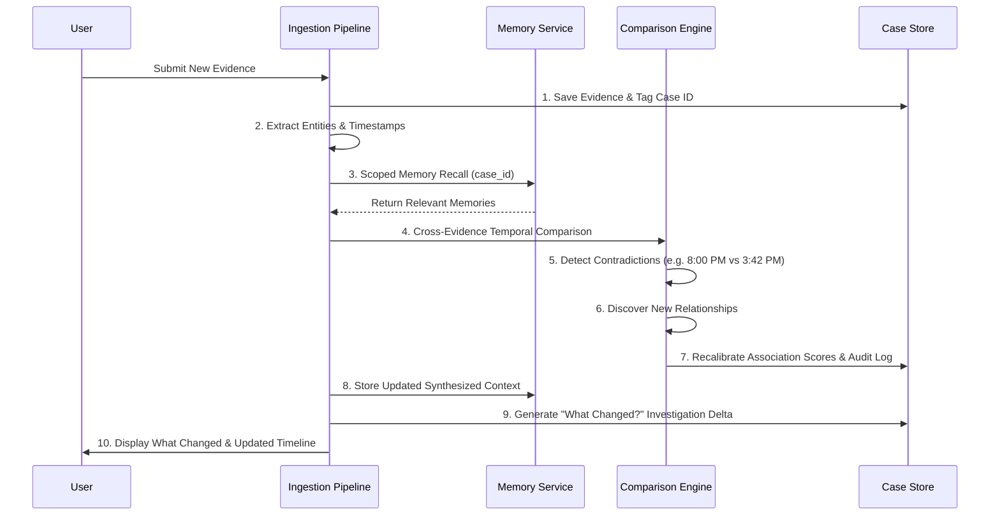

# CASEMIND: AI Investigation Assistant with Persistent Memory

**CASEMIND** is an enterprise-grade AI investigation intelligence prototype designed to help investigators understand how a complex case evolves as new evidence arrives.

Traditional investigation systems act as passive document repositories. CASEMIND combines persistent, case-isolated semantic memory with an autonomous 10-step reasoning pipeline. Every newly ingested record is automatically compared against historical case memory to detect timeline contradictions, discover hidden entity relationships, recalibrate Evidence Association Scores, and explain state evolution with **"What Changed?"** and **"Why Do We Believe This?"**.

---

## 1. What CASEMIND Is

CASEMIND is an investigative copilot that maintains continuous situational awareness over complex cases. It is built for detectives, corporate fraud analysts, compliance officers, and incident responders who need to navigate conflicting witness testimonies, disparate ERP/access logs, and surveillance reports without losing sight of timeline progression.

---

## 2. Problem

In complex investigations:
- **Evidence arrives asynchronously**: Statements and logs trickling in over days or weeks create cognitive overload.
- **Contradictions go unnoticed**: Early witness statements (e.g., claiming an 8:00 PM delivery) easily conflict with later automated system logs (e.g., recorded at 3:42 PM), but traditional databases do not autonomously flag these discrepancies.
- **Premature conclusions**: Investigators often prematurely discard conflicting evidence rather than holding it in active tension under investigative review.
- **Memory fragmentation**: LLM-based assistants lose state across sessions and easily mix up details across different concurrent cases.

---

## 3. Solution

CASEMIND solves this through:
1. **Persistent Contextual Memory**: Stores structured facts, timestamps, people, and statements across sessions.
2. **Autonomous Contradiction Detection**: Proactively detects temporal and physical clashes without declaring either source false ("Needs Review").
3. **Evidence Association Scoring**: Dynamically calibrates an entity's relationship to critical events with complete historical audit trails.
4. **Strict Context Isolation**: Prevents any cross-case data leakage between separate investigations.
5. **Transparent Explainability**: First-class **"What Changed?"** state diffs and **"Why Do We Believe This?"** provenance inspector.

---

## 4. Architecture

```mermaid
graph TD
    subgraph Frontend [Presentation Layer - Next.js 14 & Tailwind CSS]
        UI[Workspace UI]
        Dash[Dashboard View]
        Evid[Evidence Repository]
        Time[Chronological Timeline]
        Peop[People & Association Scores]
        Contra[Contradictions Panel]
        Mem[Memory Subsystem]
        WCModal["What Changed?" Modal]
        WBModal["Why Do We Believe This?" Modal]
        DemoMod[21-Step Demo Guide]
    end

    subgraph API [Next.js API Layer]
        CasesAPI[/api/cases]
        EvidenceAPI[/api/cases/:id/evidence]
        WhatChangedAPI[/api/cases/:id/what-changed]
        WhyBelieveAPI[/api/cases/:id/why-believe]
        MemoryAPI[/api/cases/:id/memory]
        SeedAPI[/api/cases/:id/seed]
    end

    subgraph Engine [Reasoning & Pipeline Engine]
        Pipeline[10-Step Ingestion Pipeline]
        EntityExtract[Entity & Temporal Extractor]
        ContraDetect[Contradiction Detector]
        ScoreEngine[Evidence Association Engine]
        DeltaGen[Investigation Delta Generator]
    end

    subgraph Storage [Persistent Storage & Memory]
        DB[(Local Database: data/casemind-db.json)]
        MemService[Memory Service Interface]
        LocalAdapter[Local Persistent Memory Adapter]
        HindsightAdapter[Hindsight API Adapter]
    end

    UI --> API
    API --> Pipeline
    Pipeline --> EntityExtract
    Pipeline --> ContraDetect
    Pipeline --> ScoreEngine
    Pipeline --> DeltaGen
    Pipeline --> DB
    Pipeline --> MemService
    MemService -->|Credentials Available| HindsightAdapter
    MemService -->|Fallback / Demo Mode| LocalAdapter
```

---

## 5. Central Ingestion & Reasoning Workflow

When new evidence is added, CASEMIND executes a deterministic 10-step pipeline:



---

## 6. Hindsight Integration

CASEMIND incorporates a modular memory architecture through `src/lib/memory/`:

- **Dedicated Interface**: `IMemoryService` specifies `addEvidence`, `recall`, `update`, `getHistory`, and `getStats`.
- **Hindsight API Adapter** (`HindsightAdapter`):
  - Integrates with Hindsight endpoints via `HINDSIGHT_API_KEY` and `HINDSIGHT_BASE_URL`.
  - Scopes memory banks by case identifier (`casemind-[caseId]`) to enforce multi-tenant isolation.
  - Gracefully falls back to local persistence if network disruptions or invalid credentials occur.
- **Local Adapter (Demo Mode)** (`LocalMemoryAdapter`):
  - Zero-configuration embedded semantic and lexical memory engine.
  - Matches the exact method signatures and semantics of the Hindsight service.
  - Automatically activates when credentials are not configured, visibly displaying:
    `Memory: Local Adapter (Demo Mode)`.

---

## 7. Strict Case Isolation

Case isolation is enforced at all layers:
- Every table and JSON record is scoped by a mandatory `case_id` (e.g., `warehouse-theft` vs `missing-equipment`).
- Memory banks in Hindsight use isolated IDs (`casemind-warehouse-theft` and `casemind-missing-equipment`).
- Query operations never query across different case IDs.
- Evidence, witnesses, and contradictions from Case 1 (Warehouse Theft) will **never** appear in Case 2 (Missing Equipment).

---

## 8. Preloaded Fictional Investigations

### Case 1: Warehouse Theft Investigation (`CASE-001`)
- **Day 1 (Witness Statement)**: "The delivery occurred at 8:00 PM."
- **Day 3 (Delivery System Log)**: "Delivery recorded at 3:42 PM."
- **Day 5 (Access Log)**: "Person A entered the warehouse at 3:35 PM."
- **Day 6 (CCTV Report)**: "Person A was near the loading area between 3:35 PM and 3:50 PM."
- **Day 7 (Second Witness)**: "The truck left around 3:50 PM."

**Expected Reconstruction**:
- `3:35 PM`: Person A enters warehouse.
- `3:35–3:50 PM`: CCTV places Person A near loading area.
- `3:42 PM`: Delivery recorded by ERP.
- `~3:50 PM`: Truck leaves perimeter gate.
- `8:00 PM`: Original witness-reported delivery time.
- **Contradiction Flagged**: Potential timeline contradiction between Day 1 witness statement and Day 3 ERP log (marked *Needs Review*).
- **Person A Association Score**: Calibrated from `72` to `58` as delivery verification established routine daytime duties.

### Case 2: Missing Equipment Investigation (`CASE-002`)
- **Day 1 (Inventory Report)**: Equipment last recorded in Storage Room A.
- **Day 2 (Access Register)**: Person B enters Storage Room A.
- **Day 3 (Movement Report)**: Equipment transferred toward Room C.
- **Day 4 (Access Log)**: Person C enters Room C.
- **Day 5 (Witness Statement)**: Equipment observed moving outside the recorded voucher window.
- **Day 6 (Updated Inventory)**: Equipment verified associated with Room C.

---

## 9. Environment Variables

Create `.env.local` using `.env.example`:

```bash
# Hindsight Semantic Memory Layer (Optional)
HINDSIGHT_API_KEY=your_hindsight_api_key_here
HINDSIGHT_BASE_URL=https://api.hindsight.vectorize.io/v1

# Application Settings
NODE_ENV=development
PORT=3000
```

> **Note**: If `HINDSIGHT_API_KEY` is not provided, CASEMIND automatically runs in zero-config **Local Adapter (Demo Mode)**.

---

## 10. Running Locally

### Prerequisites
- Node.js 18+ (tested on Node v20 and v24)
- npm or pnpm

### Installation & Run

```bash
# 1. Install dependencies
npm install

# 2. Build the production application
npm run build

# 3. Start the application
npm start
# or run in development mode:
npm run dev
```

Open **`http://localhost:3000`** in your browser.

---

## 11. Demo Flow for Judges (21-Step Walkthrough)

CASEMIND includes an interactive **Live Demo Guide** built into the interface (click `[ Demo Guide ]` in the navbar or bottom control bar):

1. **Dashboard**: View the two active fictional investigations (`CASE-001` and `CASE-002`).
2. **Inspect Isolation**: Observe separate evidence counts, entity counts, and contradiction counts.
3. **Open Warehouse Theft**: Navigate into Case 1 workspace.
4. **Show Evidence**: Inspect preloaded witness statements, CCTV reports, and access logs.
5. **Open Timeline**: View chronological order from 3:35 PM to 8:00 PM.
6. **Examine 8:00 PM Statement**: Inspect initial evening shift hypothesis.
7. **Add / Reveal 3:42 PM System Log**: Demonstrate ingestion of the ERP timestamp.
8. **Memory Recall**: Point out that CASEMIND recalled earlier Day 1 statement.
9. **Contradiction Detection**: Inspect **"Potential timeline contradiction: Delivery Time"** (marked *Needs Review*).
10. **Click "What Changed?"**: View the side-by-side delta showing New Evidence, Challenged Assumption, New Connection, Supporting Evidence, and Requires Review.
11. **Show Updated Timeline**: Note how the delivery shifted to the daytime 3:42 PM window.
12. **Open Person A**: Navigate to People tab.
13. **Click "Why Do We Believe This?"**: Inspect Person A provenance modal.
14. **Evidence Provenance**: Inspect Door D-02 access, CCTV footage, and ERP log links.
15. **Association Score History**: Show score history (`72 → 58`) with rationale.
16. **Open Memory View**: Inspect the 5-step visual pipeline diagram and memory activity feed.
17. **Test Memory Query**: Type `"delivery"` or `"Person A"` into the recall tester to demonstrate instant retrieval.
18. **Return to Dashboard**: Return to the main case selection.
19. **Open Missing Equipment**: Switch active workspace to Case 2.
20. **Inspect Case 2 Memory**: Verify only Storage Room A/Room C and Person B/Person C memories exist.
21. **Audit Case Isolation**: Confirm that Case 1 evidence (Person A, Bay 4, 8:00 PM delivery) **never** appears in Case 2.

---

## 12. Project Structure

```
├── data/
│   └── casemind-db.json            # File-backed atomic persistent database
├── src/
│   ├── app/
│   │   ├── api/
│   │   │   ├── cases/              # Case listing & isolated workspace data
│   │   │   │   └── [caseId]/
│   │   │   │       ├── evidence/   # Evidence ingestion & pipeline trigger
│   │   │   │       ├── memory/     # Memory stats, activities & recall query
│   │   │   │       ├── seed/       # Deterministic demo state reset & stepper
│   │   │   │       ├── what-changed/# State delta comparison
│   │   │   │       └── why-believe/ # Deep rationale inspector
│   │   ├── globals.css             # Dark theme styling
│   │   ├── layout.tsx              # Root HTML layout
│   │   └── page.tsx                # Central CASEMIND workspace orchestrator
│   ├── components/
│   │   ├── AddEvidenceModal.tsx    # Evidence ingestion modal with test presets
│   │   ├── ClaimsView.tsx          # Investigative hypotheses & status
│   │   ├── ContradictionsView.tsx  # Dedicated contradictions panel
│   │   ├── DashboardView.tsx       # Dual-case dashboard with isolation metrics
│   │   ├── DemoGuideModal.tsx      # 21-step interactive judge walkthrough
│   │   ├── EvidenceView.tsx        # Evidence catalog with type filters
│   │   ├── InvestigationDetailView.tsx # Executive case summary & KPIs
│   │   ├── MemoryView.tsx          # Memory architecture & recall tester
│   │   ├── Navbar.tsx              # Top bar, case switcher & provider badge
│   │   ├── PeopleView.tsx          # Evidence Association Scores & history
│   │   ├── TimelineView.tsx        # Chronological progression & state inspector
│   │   ├── UpdatesView.tsx         # Audit journal feed
│   │   ├── WhatChangedModal.tsx    # "What Changed?" side-by-side comparison
│   │   └── WhyBelieveModal.tsx     # "Why Do We Believe This?" deep audit
│   └── lib/
│       ├── db.ts                   # Persistent database and seed state
│       ├── pipeline.ts             # 10-step ingestion & reasoning engine
│       ├── types.ts                # TypeScript data interfaces
│       └── memory/
│           ├── hindsightAdapter.ts # Hindsight API adapter (bank isolation)
│           ├── localMemoryAdapter.ts # Local semantic memory fallback
│           ├── index.ts            # Memory service factory
│           └── types.ts            # IMemoryService interfaces
├── .env.example                    # Environment variable template
└── README.md                       # Documentation
```

---

## 13. Limitations

- **Simulated LLM Ingestion**: While the lexical and semantic memory indexing, contradiction heuristics, and entity linkage are functional, deep natural language parsing of arbitrary unformatted audio/video transcripts relies on client-provided structured metadata fields.
- **Memory Adapter Scope**: When using the local fallback adapter, memory recall relies on token-overlap and tag scoring rather than dense vector embeddings. Enabling Hindsight API activates true external semantic vector recall.

---

## 14. Future Improvements

1. **Audio/Video Ingestion**: Direct transcription of 911 calls and body-worn camera feeds via Whisper.
2. **Graph Visualization**: Interactive 2D/3D force-directed knowledge graph linking entities, vehicles, and access gates.
3. **Chain-of-Custody Cryptographic Hashing**: SHA-256 digital signatures for physical evidence tracking.
4. **Autonomous Hypothesis Generation**: Bayesian belief networks evaluating competing investigative theories.
